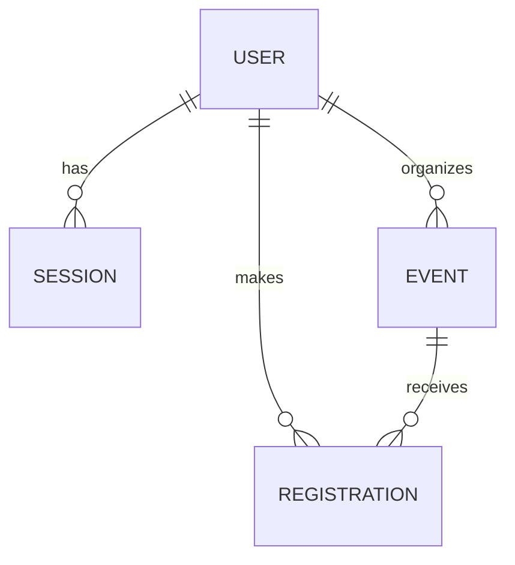

# System-Level SDS (v1.0)

## 1. Architecture and stack
Modular monolith: UI (React/Vite) → REST API (Express/TypeScript) → PostgreSQL (Prisma).
- UI: display and forms, no security rules.
- API: authentication, authorization, validation (zod), business rules BR-01 to BR-09.
- Database: integrity constraints (UNIQUE, CHECK capacity > 0, foreign keys).
Communication: HTTP/JSON, httpOnly session cookie.
Critical rules (capacity, duplicates) are enforced server-side inside a transaction using SELECT ... FOR UPDATE on the event row, and backed by database constraints.

## 2. Data model
| Entity | Main fields | Constraints |
|---|---|---|
| User | id, email, passwordHash, role | unique email; role ∈ {PARTICIPANT, ORGANIZER} |
| Session | id (random token), userId, expiresAt | cascade delete with the user |
| Event | id, title, startsAt, capacity, status, organizerId | capacity > 0; status ∈ {DRAFT, PUBLISHED}; organizerId → User |
| Registration | id, eventId, userId, status, createdAt | UNIQUE(eventId, userId); status = CONFIRMED (Sprint 1) |

Ownership: an Event belongs to its organizer; a Registration belongs to its participant.

## 3. Migrations and demo data
Prisma migrations (`npx prisma migrate dev`). Reproducible seed (`npm run db:seed`): 2 organizers, 3 participants, 1 published event and 1 draft event per organizer. Demo passwords are read from the environment and never committed.

## 4. UI, API, roles, authentication, configuration
(Section written by B)

## 5. GCP deployment plan
Target: Cloud Run (application container), Cloud SQL PostgreSQL (durable storage), Secret Manager (secrets). Docker image built in Lab 5. Environment variables: DATABASE_URL, SESSION_TTL_HOURS, SEED_PASSWORD. No secrets in Git or in client code.

